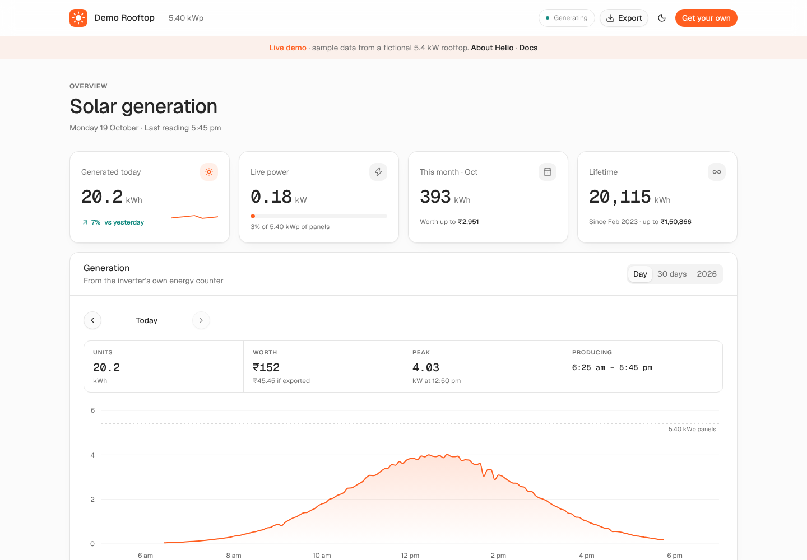
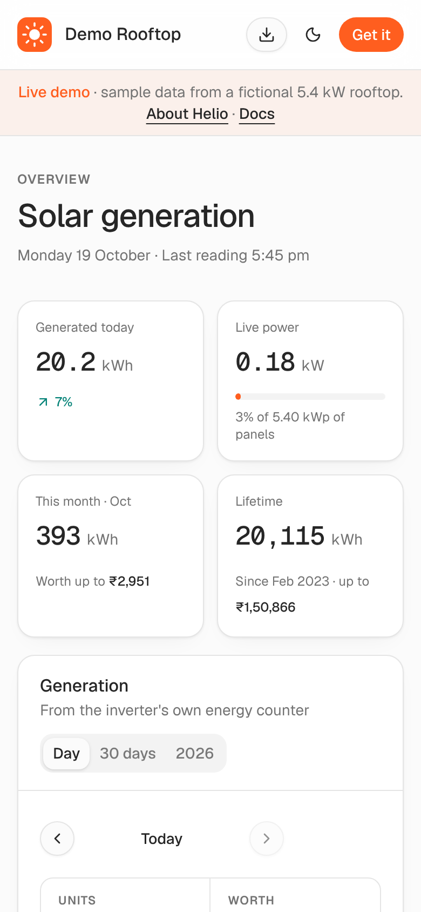
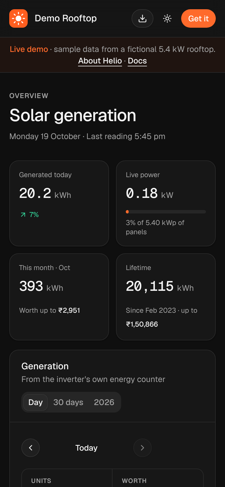
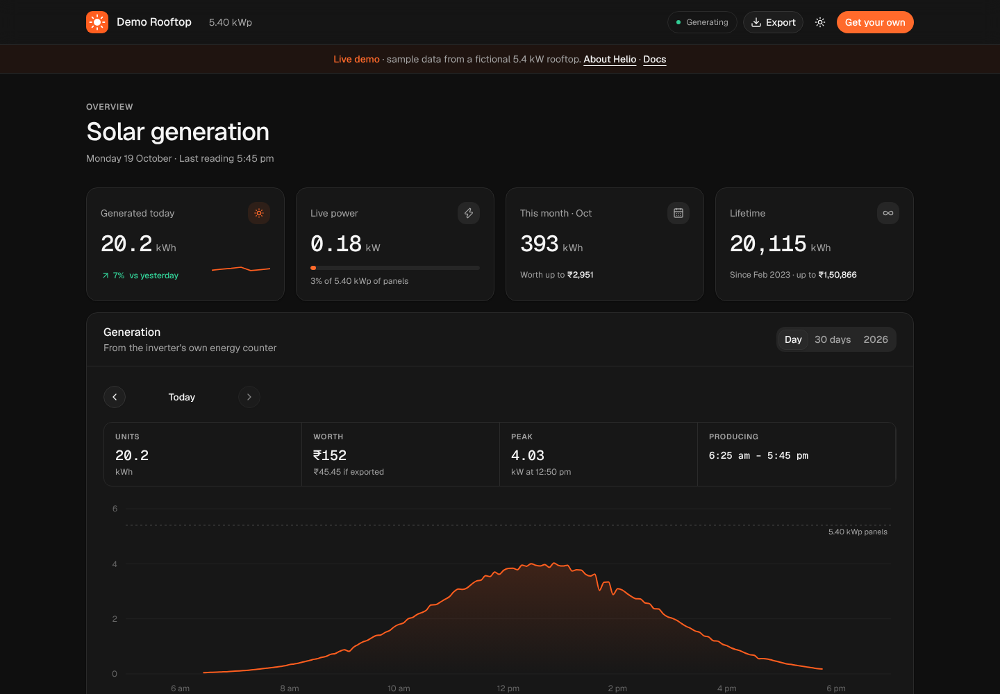
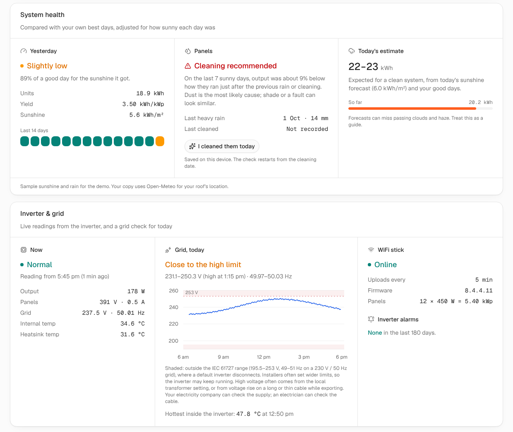

<div align="center">


# Helio

**Know exactly what your roof made today.**

A private, open-source dashboard for rooftop solar systems that report to ShineMonitor through an Eybond WiFi stick, the setup behind the SmartClient app.

[](https://github.com/byrishi/helio/actions/workflows/ci.yml)
[](https://github.com/byrishi/helio/actions/workflows/codeql.yml)
[](https://github.com/byrishi/helio/actions/workflows/secret-scan.yml)
[](https://scorecard.dev/viewer/?uri=github.com/byrishi/helio)
[](https://snyk.io/test/github/byrishi/helio)
[](.github/dependabot.yml)
[](LICENSE)

[Website](https://helio.rishishah.in) · [Live demo](https://helio.rishishah.in/demo) · [Docs](docs/README.md)

[](https://vercel.com/new/clone?repository-url=https%3A%2F%2Fgithub.com%2Fbyrishi%2Fhelio&project-name=helio&repository-name=helio&env=SHINE_USER,SHINE_PASS,DASH_USER,DASH_PASSWORD,AUTH_SECRET,TARIFF&envDescription=Your%20ShineMonitor%20login%2C%20a%20dashboard%20login%2C%20and%20your%20electricity%20rate.&envLink=https%3A%2F%2Fgithub.com%2Fbyrishi%2Fhelio%2Fblob%2Fmain%2Fdocs%2Fconfiguration.md)

<br />



</div>

## Why

The official apps show the right numbers, but they're slow, cluttered and hard to read on a phone. Helio shows the same numbers, from the same cloud, as a fast private dashboard you host yourself for free.

## What you get

- **Exact daily units** from the inverter's own energy counter, not estimated from a graph
- **Live power** in kW and as a share of your system's capacity, with a *Generating / Idle / No recent data* status
- **Any past day** in detail: units, value, peak power and when it hit, producing hours, a 5-minute power curve
- **History:** the last 30 days with average and best day, every month of the year, and a daily log you can click into
- **What it's worth** in your currency, with separate rates for units you use and units you export. Rates can be edited right on the dashboard
- **System health:** each day scored against your own best days, adjusted for how sunny it was, so a cloudy day isn't mistaken for a fault
- **Cleaning advice:** tells you when dust is likely costing output, measured against how the panels did after the last rain or cleaning
- **Today's estimate:** the range a clean system should make today, from the sunshine forecast
- **Inverter and grid:** live panel voltage and current, grid voltage and frequency, temperatures, and a daily grid check with high-voltage trips and output stops
- **Alarms and WiFi stick:** the inverter's alarm history and whether the datalogger is online
- **CSV export:** daily and monthly files with clearly labelled units, ready for Excel or Google Sheets
- **Location is automatic** from your ShineMonitor plant, with a one-tap fallback
- **Private by default:** a password-protected dashboard; your ShineMonitor login never reaches the browser
- **Made for phones**, with light and dark themes and nothing to install
- **Free to run** on Vercel: no database, no server to look after

<table>
  <tr>
    <td></td>
    <td></td>
    <td></td>
  </tr>
</table>



## Will it work for me?

Yes, if your inverter has an **Eybond WiFi datalogger** (a small black stick with a QR code and `PWR COM NET SRV` lights) and you can see today's energy at **[shinemonitor.com](https://www.shinemonitor.com)** or in the SmartClient app.

Stick offline? Follow [Connect the WiFi stick](docs/wifi-stick.md). No account yet? See [ShineMonitor account](docs/shinemonitor-account.md).

## Quick start

1. Click **Deploy with Vercel** above and sign in with GitHub.
2. Fill in six values:

   | Variable | Value |
   |---|---|
   | `SHINE_USER` / `SHINE_PASS` | Your ShineMonitor login |
   | `DASH_USER` / `DASH_PASSWORD` | A new login for your dashboard |
   | `AUTH_SECRET` | Any long random text (`openssl rand -hex 32`) |
   | `TARIFF` | What you pay per unit, e.g. `7.5` |

3. Deploy, open your link, sign in. Today's units should match shinemonitor.com exactly.

Optional: `EXPORT_TARIFF`, `CURRENCY`, `LOCALE`, `TIMEZONE`, `SITE_LAT` / `SITE_LON`, `SYSTEM_KWP`, and more in [Configuration](docs/configuration.md). How the health, cleaning and grid checks work: [Health and inverter checks](docs/health-and-inverter.md).

## Limitations

Helio is deliberately small. Before you set it up, know that:

- **It only supports Eybond / ShineMonitor.** Solarman, Growatt, SolisCloud, Sungrow and others aren't supported yet.
- **It uses ShineMonitor's unofficial web API**, the same one their website uses. It could change without notice.
- **It shows generation only.** It knows nothing about home consumption, grid import or export, or batteries.
- **Money values are a range**, between all-exported and all-used-at-home, because consumption isn't measured.
- **History starts when your stick first came online.** The lifetime total is the exception.
- **There's one shared login**, and brute-force lockout is per server instance. Use a strong password.
- **Health and cleaning checks need about 7 days of history** and work best with weather data. Dust, new shade and a failing panel look alike.
- **Inverter readings depend on your model.** Fields your inverter doesn't report aren't shown.
- **5-minute resolution, one plant per deployment, English only.**

Full list: [docs/limitations.md](docs/limitations.md).

## Security

Signed, `httpOnly` session cookies; every data route checks the session twice; secrets never ship to the browser; strict security headers; `no-store` on data; Next.js 15.5+. No analytics or trackers. Besides ShineMonitor, the only outside service is Open-Meteo for weather, which receives your roof's coordinates rounded to about 1 km (turn it off with `WEATHER=off`). Known gaps and how to report issues: [docs/security.md](docs/security.md).


### Automated checks

Every push and pull request is checked in the open. Click any badge at the top to see the latest run.

| Check | What it does |
|---|---|
| **CI** | Installs from the lockfile, runs `npm audit` (fails on moderate or worse), type-checks and builds |
| **CodeQL** | GitHub's static analysis with the `security-extended` queries, on every push and weekly |
| **Secret scan** | Gitleaks scans the full git history for keys, tokens and passwords |
| **OpenSSF Scorecard** | Grades the repo's security practices: pinned actions, token permissions, branch protection and more |
| **Snyk** | Independent check of the dependency tree against Snyk's vulnerability database |
| **Dependabot** | Opens a pull request when a dependency or GitHub Action has an update or a fix |
| **Dependency review** | Blocks pull requests that add a dependency with a known vulnerability |

All workflow actions are pinned to exact commits and run with read-only tokens unless they need more.

## Documentation

| | |
|---|---|
| [Getting started](docs/getting-started.md) | [Configuration](docs/configuration.md) |
| [Connect the WiFi stick](docs/wifi-stick.md) | [Accuracy and savings](docs/accuracy-and-savings.md) |
| [ShineMonitor account](docs/shinemonitor-account.md) | [Troubleshooting](docs/troubleshooting.md) |
| [Limitations](docs/limitations.md) | [API](docs/api.md) |
| [Security](docs/security.md) | [Architecture](docs/architecture.md) · [FAQ](docs/faq.md) |
| [Health and inverter checks](docs/health-and-inverter.md) | |

## Develop

```bash
git clone https://github.com/byrishi/helio.git && cd helio
npm install
npm run dev        # http://localhost:3000/demo works with no setup
```

Next.js 15 · React 19 · TypeScript · Tailwind CSS v4 · [Watermelon UI](https://ui.watermelon.sh) · Recharts. Contributions are welcome, especially support for other monitoring clouds; see [CONTRIBUTING.md](CONTRIBUTING.md).

## License

[MIT](LICENSE). Designed and built by [Rishi Shah](https://rishishah.in).

Helio is an independent project. It is not affiliated with or endorsed by Eybond, ShineMonitor, SmartClient, or any inverter, panel or utility company; their names are used only to describe compatibility. Figures are provided as-is. For billing, rely on your utility meter.
