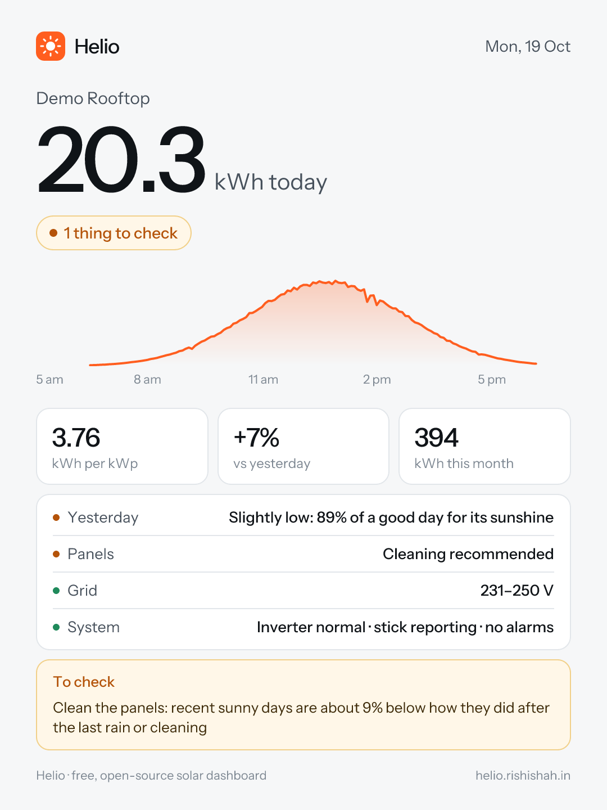

# Daily alert

Every evening, between 6:30 and 7:30 pm India time by default, Helio sends one Telegram message with today's units and anything that needs a look. It arrives as a **Helio-branded image** with today's power curve, and its caption lists what to check. It comes from the **Helio Solar** bot, so there's nothing to build.



## Connect in two steps

1. On your dashboard, open **Daily alert → Connect Telegram** and press **Start**. The Helio Solar bot replies with your connect code.
2. In Vercel, open your Helio project → **Settings → Environment Variables**, add `TELEGRAM_LINK` with that code, and redeploy.

Then tap **Send a test alert**. That's it: the daily schedule is already in `vercel.json`.

## What it says

The image is drawn on your own server. If it can't be made, Helio sends the full text instead. The text version has the same sections in the same order every day; lines only appear when there's data for them.

```
☀️ My Rooftop · Mon, 19 Oct
21.4 kWh today · ⚠️ 1 thing to check

Generation
• 3.96 kWh per kWp of panels
• Expected 21–23 kWh for clean panels in today's sunshine
• Yesterday 22.0 kWh, today 3% lower
• This month 401 kWh so far

Health
• Yesterday was good: 96% of a good day for its sunshine
• Panels: looking clean, within 3% of how they did after the last rain or cleaning

Grid
• Voltage 236–259 V, highest at 12:40 pm (standard limit 253 V)
• Above the limit 2 times, about 1 h 50 min in all; longest 11:05 am–12:45 pm. Inverter kept running
• Frequency 49.91–50.08 Hz, normal

System
• Inverter: Normal, hottest 61 °C at 1:20 pm
• WiFi stick: reported until 6:05 pm, every 5 min
• Alarms today: none

To check
• Grid voltage was above 253 V for about 1 h 50 min (peak 259 V). Ask your electricity company to check the supply voltage.
```

**To check** lists only things you can act on:

- data stopping during the day, or no data at all (the WiFi stick going quiet after sunset is normal and isn't flagged)
- no units on a sunny day, or yesterday scoring **low** for its sunshine
- **cleaning recommended**
- grid voltage above or below the standard range, frequency out of range, output stops and likely trips
- the inverter reporting a status other than normal, and inverter alarms raised today

These are the same checks as on the dashboard. See [Health and inverter checks](health-and-inverter.md).

## How the Helio Solar bot works

- Your connect code holds your Telegram chat id plus a signature only the bot can make. It lets your Helio message **your** chat and nothing else.
- Your Helio sends the finished message to the bot's relay at `helio.rishishah.in`, which passes it straight to Telegram. The relay **stores nothing**: no database, no message log.
- The message contains your plant's name and readings. Your ShineMonitor login and dashboard password never leave your Helio.
- To stop: remove `TELEGRAM_LINK` and redeploy, or block the bot in Telegram.

## Prefer your own bot?

If you'd rather nothing passes through the relay:

1. In Telegram, message **@BotFather**, send `/newbot`, and copy the token.
2. Send any message to your bot, then open `https://api.telegram.org/bot<token>/getUpdates` and copy `chat.id`.
3. Add `TELEGRAM_BOT_TOKEN` and `TELEGRAM_CHAT_ID` in Vercel instead of `TELEGRAM_LINK`, and redeploy.

## Settings

| Variable | What it does |
|---|---|
| `TELEGRAM_LINK` | Connect code from the Helio Solar bot |
| `TELEGRAM_BOT_TOKEN`, `TELEGRAM_CHAT_ID` | Your own bot instead |
| `ALERT_ONLY_ISSUES` | `true` to send only on days with something to check |
| `CRON_SECRET` | Optional. When set, only Vercel's scheduler (which sends it) can trigger the daily job |
| `APP_URL` | Link added to the message; default is your Vercel production address |
| `TELEGRAM_RELAY_URL` | For forks running their own relay |

Without `CRON_SECRET`, the daily job accepts only requests that identify as Vercel Cron and runs at most once every 20 hours. The worst a fake call could do is send you your own summary early. Set `CRON_SECRET` to rule that out.

## Changing the time

The schedule is in `vercel.json`: `"0 13 * * *"`, 13:00 UTC. Times are in UTC, so change the hour for your time zone, for example `"0 17 * * *"` for around 6 pm in Berlin in winter. On Vercel's free plan a job runs once a day and [can start any time within that hour](https://vercel.com/docs/cron-jobs/usage-and-pricing), so `0 13` means 13:00–13:59 UTC, 6:30–7:29 pm in India.
